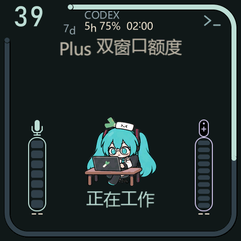

# Mosaico Agent Monitor

把 Claude Code / Codex 的任务状态和额度显示在 ESP-Mosaico V1.2（ESP32-S31、16 MiB Flash）上。保留初音动画、重力四向旋转、双击切换任务和热点配网，新增附近 Wi-Fi 扫描。

左上角数字和外圈表示**七天剩余额度**。顶部右侧显示平台名；平台返回五小时窗口时，增加 **`5h 剩余百分比 重置倒计时`**。倒计时为 `小时:分钟`，五小时剩余低于 15% 时标红。Pro 未返回五小时窗口时隐藏该行。缺失/过期额度显示 `--`，真实零额度显示 `0%`，不会影响任务状态。

## 直接使用（Windows x64）

从 [Releases](https://github.com/buyun00/mosaico-agent-monitor/releases) 下载 `mosaico-agent-monitor-0.15.0-windows-x64.zip`，解压到固定目录。包内已带 Node.js 24 和 esptool 5.4，无需安装开发环境。

1. **设备首次安装：**关机，按住 BOOT 开机进入 ROM 下载模式。确认串口后，在终端执行 `Flash.cmd COM5`（替换实际端口）。脚本验证 SHA-256 后写入 bootloader、分区表、应用和动画资源，保留 NVS/PHY，不整片擦除。目标必须是 ESP32-S31 / 16 MiB。
2. **电脑初始化：**双击 `Initialize.cmd`。默认接入 CC 和 Codex；只用一个平台可执行 `Initialize.cmd --platforms codex` 或 `--platforms claude`。它备份并合并用户级 Hook 配置，保留已有 Hook；已有 CC Status Line 会由包装器继续执行。
3. **平台确认：**Codex 新会话打开 `/hooks`，检查并信任 Mosaico 处理器；CC 重启会话加载 Hook/Status Line。无需在设备上输入账号或 API Key。旧版 Codex 不支持这些 Hook 时请升级；电脑端额度查询仍可独立工作。
4. **热点配网：**连接设备显示的 `FLUIDBOX-SETUP` 热点及随机密码，打开 `http://192.168.4.1`，扫描并选择 Wi-Fi，输入密码和电脑窗口显示的 `Device URL`。隐藏网络可手填 SSID；开放网络密码可留空。
5. **日常运行：**使用 `Start.cmd`。需要自启时先关闭前台实例，再运行 `scripts/Install-Autostart.ps1`；检测到 StartupHub 时接入管家，其他电脑创建当前用户登录任务。保持解压目录位置稳定。

电脑和设备须能在局域网互访。防火墙阻挡时，以管理员身份运行 `scripts/Allow-LAN.ps1`，只允许私有网络的本地子网访问数据端口。AP 隔离、访客网络、VPN 或 DHCP 地址变化可能需要调整网络或重新填写地址。电脑仪表盘位于 `http://127.0.0.1:8769/`。

这是独立监控固件，会替换设备原有系统应用。四镜像脚本所保留的 NVS/PHY 指本版布局中的 `0x9000–0xefff` 和 `0xf000–0xffff`；不承诺迁移不同原厂布局的其他数据。安装器识别 `CODEX_HOME` / `CLAUDE_CONFIG_DIR`；也可指定 `--codex-home` / `--claude-home`。搬动电脑包后重新运行初始化程序，使平台 Hook 指向新位置。

首次刷机请使用四镜像脚本。另附 `mosaico-agent-monitor-0.15.0-full.bin`，从 `0x0` 写入，供平台刷机工具使用；这个合并镜像的空白区包含 NVS，因此会清空已有配网，刷完需重新配置。不要混用两种安装方式，也不要只写应用镜像。需要恢复原厂系统时使用 [官方恢复指南](https://mosaico.espressif.com/zh/firmware-update/)。

## 项目结构与适配

- `firmware/`：完整应用源码、热点配网页面和分区配置。
- `assets/`：与固件索引匹配的动画资源。
- `host/`：无第三方 npm 依赖的电脑服务、配置工具和平台适配。
- `host/adapters/example.mjs`：其他 Agent 的最小上报示例。
- `docs/protocol.md`：稳定的统一数据格式，社区适配无需修改设备固件。
- `scripts/`：校验刷机、可选自启和防火墙配置。

运行源码需要 Node.js 22+：`node host/setup.mjs`，然后 `node host/server.mjs`。电脑端核心可在 Windows/macOS/Linux 运行；Windows 提供即用包，其他系统需自行安装 Node.js。CI 检查 Windows/Linux 的平台适配逻辑；macOS 和其他系统的真机会话、自启与刷机不在本版验收范围。

同时运行多个平台时，默认以最近有事件的任务决定起始平台，双击设备切换任务及其对应平台额度。启动配置可使用 `--display codex` 或 `--display claude` 设置无任务时的默认显示平台。任务来自真实 Hook，不读取原始会话数据库，不额外调用模型生成任务名或进度；模型思考/写代码是由事件及工具名映射的动画状态。

原麦克风/遥控器电量协议保留。已有电量采集服务可用 `--battery PATH` 指定其 JSON 文件；否则读取 `~/.mosaico-agent-monitor/device-battery.json`。本包不安装外设驱动，没有电量来源时显示 `--`。

## 验证与许可

构建、额度边界、HTTP、配置安装以及生产 C 渲染器检查见 [验证记录](docs/verification.md)。新版本未在设备上烧录，热点 RF 扫描、真实 CC 会话和登录自启仍需实机验收；主机预览与 30 FPS 素材时间轴不代表设备帧率。

代码沿用 MIT 许可；显示初始化保留上游 Apache-2.0 说明。第三方代码和素材说明见 [NOTICE](NOTICE) 与 [assets/README.md](assets/README.md)。发布包不含作者的 Wi-Fi 配置、NVS 备份、账号凭据或会话数据。
